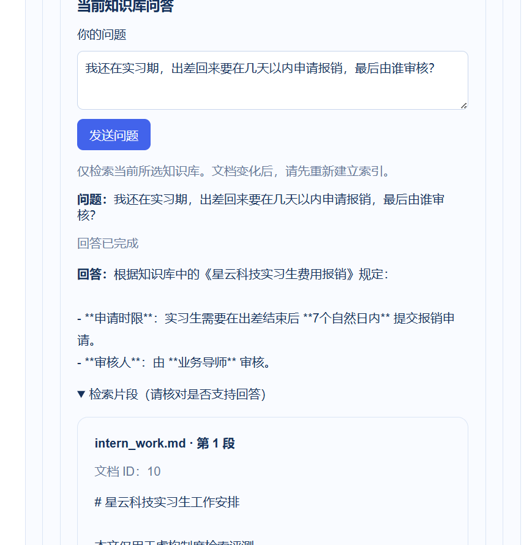
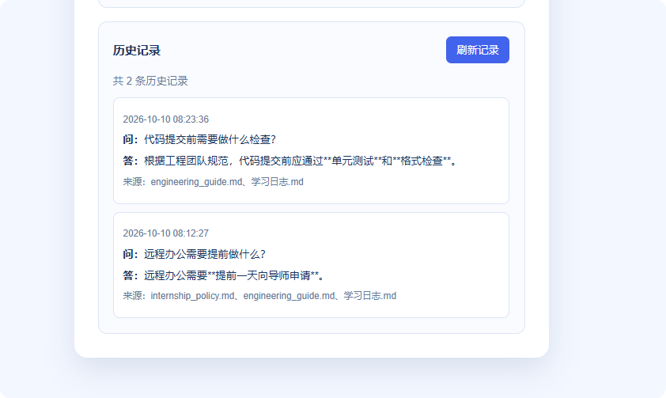
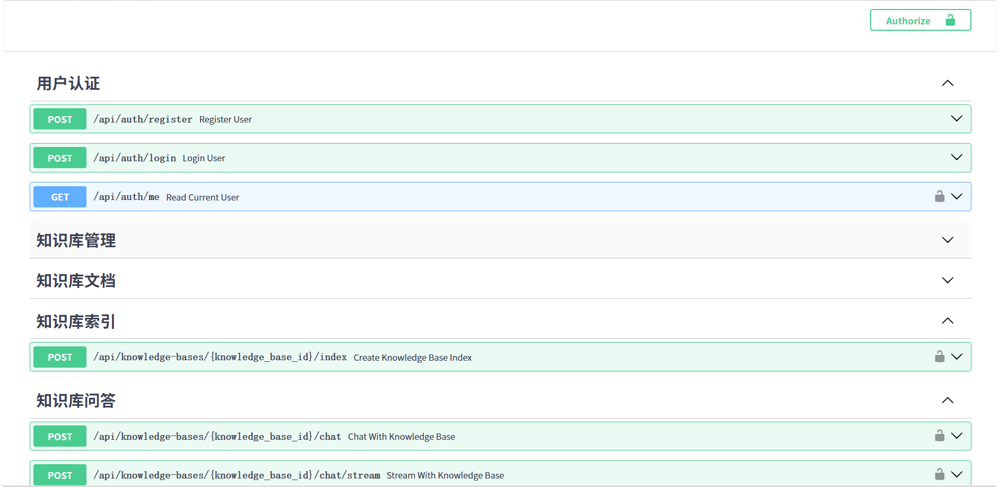

# 文档知识库问答助手

面向本地校园资料的 RAG 知识库问答应用，支持文档上传、向量检索、来源引用和历史记录。

用户可以上传 `.txt` 或 `.md` 文件，点击建立索引后，再根据上传的资料提问。系统会先从资料里找相关内容，再让大模型根据这些内容回答。

## 核心功能

- 支持上传 UTF-8 编码的 TXT、Markdown 文档
- 查看和删除已上传文件及对应的向量片段
- 文档切分、向量化，使用 Chroma 检索相关内容
- 根据检索内容生成回答，展示来源文件和引用片段
- 对知识库里没有的问题，提示“没有找到相关信息”
- 使用 SQLite 保存问答历史记录
- 刷新网页后还能看到以前的提问记录
- 支持流式返回，用户体验更佳
- 支持使用 Docker 运行后端

## 用到的技术

- React：做前端页面
- Vite：启动 React 开发环境
- FastAPI：写后端接口
- LangChain：处理 RAG 流程
- Chroma：保存文本向量，查找相似内容
- DeepSeek API：生成最终回答
- SQLite：保存聊天记录

## 项目结构

```text
app/
  main.py       后端接口，比如上传、建索引、提问、读取历史记录
  rag.py        文档切分、向量检索、调用大模型

frontend/
  src/App.jsx   React 页面主要代码
  src/index.css 页面样式
  vite.config.js Vite 代理配置

data/
  knowledge/    上传的知识库文件
  vector_store/ Chroma 建好的向量索引
  chat_history.db 聊天历史数据库
```  

## RAG 流程

### 上传文件
→ 保存到 data/knowledge
→ 把文件切成多个片段
→ 把片段转成向量
→ 保存到 Chroma

### 用户提问

→ Chroma 找最相似的几个片段
→ 把片段和问题一起发给大模型
→ 返回回答、来源文件和引用片段

## 项目截图
### 上传并建立向量索引



### 问答历史与来源引用



### FastAPI 接口文档



### 本地启动
本地后端和 Docker 后端选择一种启动，两者默认都使用 8001 端口，不要同时启动

本地启动后端
先进入项目根目录：
cd campus-rag-assistant

第一次运行时安装 Python 依赖：
python -m venv .venv
.\.venv\Scripts\Activate.ps1
python -m pip install -r requirements.txt

复制环境变量文件：
Copy-Item .env.example .env

打开 .env，填写自己的 API Key：
OPENAI_API_KEY=你的真实密钥
OPENAI_BASE_URL=https://api.deepseek.com
CHAT_MODEL=deepseek-v4-flash

### 启动后端：
uvicorn app.main:app --reload --port 8001
后端接口文档地址：
http://127.0.0.1:8001/docs

### 启动前端
新开一个终端：
cd D:\codex_create\2026-09-09\ai-python-rag-python-api-langchain\frontend
npm install
npm run dev

浏览器打开：
http://localhost:5173

## 使用 Docker 启动后端

先在项目根目录配置好 `.env`，然后构建镜像：

```powershell
docker build -t document-rag-assistant .
```

第一次运行：

```powershell
docker run --name document-rag -p 127.0.0.1:8001:8001 --env-file .env -v "${PWD}/data:/app/data" document-rag-assistant
```

看到启动成功后，访问 http://127.0.0.1:8001/health，返回 `{"status":"ok"}` 即正常。

在终端按 Ctrl + C 停止。下次启动直接执行：

```powershell
docker start -a document-rag
```

数据保存在本机项目的 `data` 目录。React 前端单独启动：

```powershell
cd frontend
npm run dev
```

### 使用方法
1. 上传一个 .txt 或 .md 文件。
2. 点击“建立 / 重建索引”。
3. 在聊天框输入问题。
4. 查看回答、来源和引用片段。
5. 在历史记录区域查看之前问过的问题。

### 接口
- POST /api/upload：上传文件
- POST /api/index：建立索引
- POST /api/chat：普通问答
- POST /api/chat/stream：流式问答
- GET /api/history：读取聊天历史
- GET /health：检查后端是否启动
- GET /api/files：查看文件列表
- DELETE /api/files/{filename}：删除文件及对应的向量片段

## 设计说明
- 前端通过 Vite 代理将 `/api` 请求转发至 FastAPI，避免开发环境跨域问题。
- 上传文件后需建立或重建向量索引，才可参与后续语义检索。
- API Key 使用 `.env` 管理，并通过 `.gitignore` 防止提交敏感配置。

## 接口测试

先启动后端，再在项目根目录执行：

```powershell
python -m pip install requests
python -m unittest discover -s tests -v
```

测试使用 unittest 和 requests，检查文件上传校验、同名上传和删除相关行为。

如果本机代理导致 ProxyError，在运行测试的 PowerShell 中先执行：

```powershell
$env:NO_PROXY = "127.0.0.1,localhost"
```

测试会创建随机命名的文件，并在正常执行清理步骤时删除它。

## PDF 与指定文件检索

- 支持 UTF-8 编码的 TXT、Markdown 和文字版 PDF。
- PDF 检索片段显示页码，按 PDF 第一页为 1 计数。
- 暂不支持加密 PDF 和纯扫描件。
- React 页面可选择检索全部文件或指定文件。
- 在问题中写文件名不会自动限定范围，需要使用“检索范围”下拉框。
- 检索片段是候选资料，不保证每个片段都实际支持回答。

## 流式问答

- React 页面使用 POST /api/chat/stream 接收 NDJSON 数据流。
- 事件包括 metadata、token、done 和 error。
- 回答完整生成并成功保存后，才发送 done 事件。
- 生成中断时，页面提示回答未完成，不保存半截回答。
- 流式显示不消除检索和模型首段生成的等待时间。
- 历史记录目前保存问题、回答和来源，不保存检索范围及片段页码。